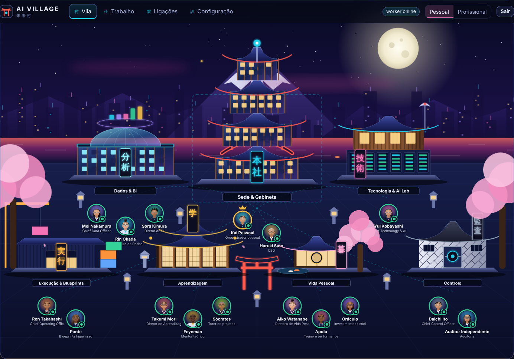
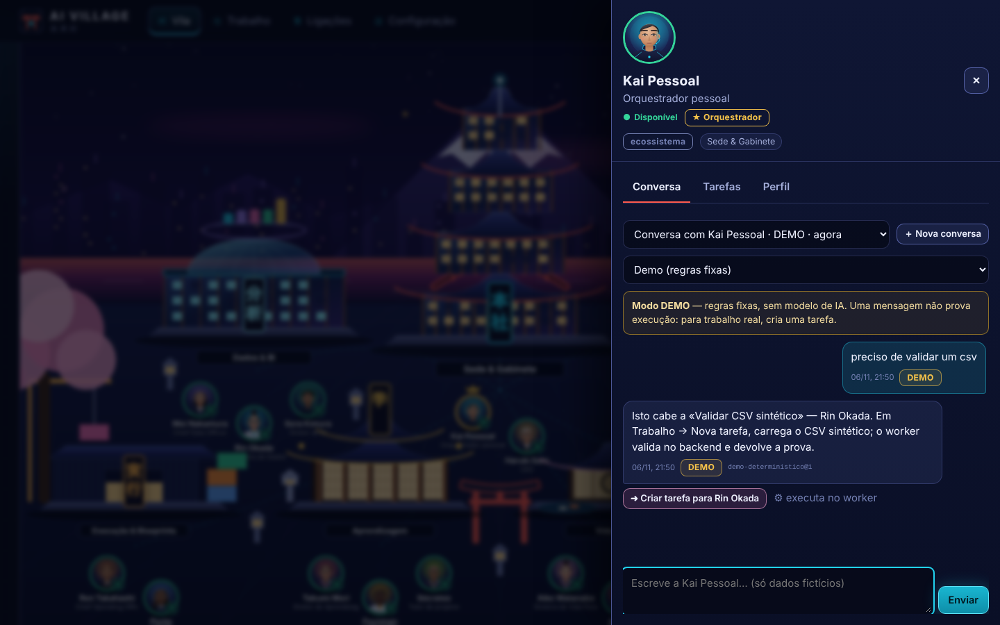
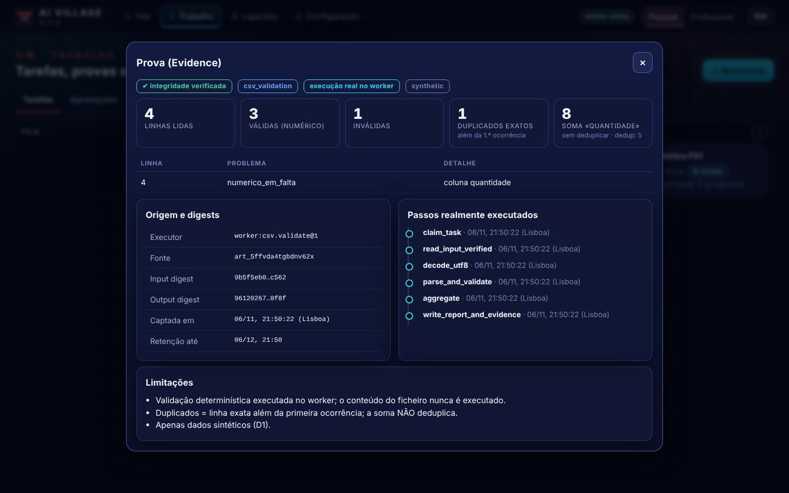
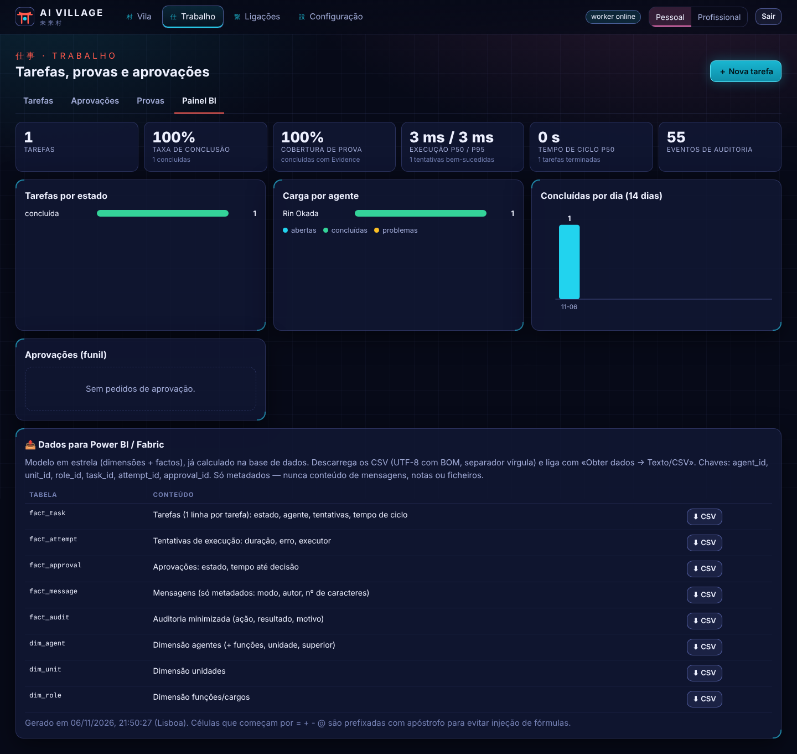

# 未来村 · AI Village

Uma **empresa de agentes de IA** que vive numa **vila japonesa futurista**. Falas com um CEO, C-levels, diretores e especialistas; delegas tarefas; o trabalho é executado **a sério no backend** (não é maquete), fica provado, e tudo persiste numa **BD própria**.

Desenhada a partir da pasta **Source_of_truth** do Drive (arquitetura de agentes `06_`, requisitos e critérios de aceitação `11_AI_Village_App`). Pensada para quem é especialista em BI: painel de KPIs e **export em estrela (dim_/fact_) para Power BI/Fabric**.



## Arranque (2 minutos, sem credenciais)

Requisitos: **Node ≥ 22.13**. Sem `npm install` — não há dependências.

```bash
cd ai-village
VILLAGE_PASSCODE=muda-isto npm start      # http://127.0.0.1:4173
```

Sem `VILLAGE_PASSCODE`, é gerado um passcode **mostrado uma vez** na consola. O servidor arranca também o **worker** (processo separado) que executa as tarefas.

1. Abre a app → **Primeiros passos → ▶ Executar cenário guiado F01**.
2. O worker valida uma fixture CSV sintética e devolve a prova: **4 lidas · 3 válidas · 1 inválida · 1 duplicado · soma 8**.
3. Em **Trabalho → Provas** abre a prova: passos reais, digests, limitações, integridade verificada.

## O que tem

| Destino | O que fazes lá |
|---|---|
| **Vila** | Mapa (SVG, noite, néon, madeira e vidro) **ou** lista — as mesmas ações. Cada **unidade** é um edifício; cada **agente** está à porta. Clica para conversar, ver tarefas, perfil. Estado real: *ocupado* só com tentativa de execução em curso |
| **Trabalho** | Quadro de tarefas · **Aprovações** (ações **simuladas**, de uso único) · **Provas** · **Painel BI** (+ export CSV) |
| **Ligações** | Inventário **honesto** de contas/modelos: «planeada», «demo», «ligada (com prova datada)», «degradada», «revogada» |
| **Configuração** | **Organização** (unidades, funções, agentes — sem código), permissões de delegação, definições/retenção, auditoria (cadeia de hashes), capacidades, backup |

**Dois mundos** (seletor no topo): **Pessoal** (dados fictícios; executa) e **Profissional** (só desenho nesta conta). Um orquestrador por mundo: *Kai Pessoal* / *Kai Profissional*. CEO e diretores são **cargos da app**, não orquestradores.



### Conversa: DEMO vs REAL
Cada mensagem fica gravada no backend com o modo. **DEMO** = regras fixas + dados reais da BD (estado, tarefas, equipa) e *sugestão de encaminhamento* → «Criar tarefa para Rin Okada». **REAL** = modelo via API (G2), só com ligação verificada e âmbito concedido; falhas nunca viram demo em silêncio. Uma mensagem **não prova execução**: trabalho real = tarefa.

### Provas e aprovações

Concluir exige **resultado + prova**. Ações consequentes passam por **intenção → aprovação (payload exato, digest, validade) → execução uma só vez**. Nesta fase são **simulações** (sem saída de rede).

### Para BI

KPIs (conclusão, cobertura de prova, p50/p95 de execução, tempo de ciclo, funil de aprovações) calculados na BD. **8 tabelas CSV** (`fact_task`, `fact_attempt`, `fact_approval`, `fact_message`, `fact_audit`, `dim_agent`, `dim_unit`, `dim_role`) — só metadados; liga com *Obter dados → Texto/CSV*.

## Adicionar agentes e funções (a tua pergunta-chave)

Sem código: **Configuração → Organização → ＋ Função / ＋ Agente / ＋ Unidade** (um edifício novo aparece na vila). O servidor impede ciclos, um 2.º orquestrador e arquivar agentes com tarefas ativas sem reencaminhar. O retrato é editável (e aceita uma **fotografia real** tua).
Para dar **execução automática** a uma capacidade nova: uma entrada em `server/modules/capabilities.js` (com `executor` determinístico) + um teste. Ver [`docs/ARCHITECTURE.md` §10](docs/ARCHITECTURE.md).

## As tuas contas (pessoais e profissionais)

Por desenho da Source_of_truth (D1): **o mundo pessoal só recebe dados fictícios** e **o profissional é só desenho** nesta conta. Não há, portanto, sincronização de contas reais — e a guarda D1 recusa emails reais, IBAN, NIF, cartões e credenciais. O que existe:
entrada de ficheiros **sintéticos/higienizados**, adaptador da **Claude API** (G2) e o inventário honesto das restantes ligações. Detalhe e passo a passo em [`docs/CONNECTORS.md`](docs/CONNECTORS.md).

## Qualidade e verificação

```bash
npm test            # 35 testes: núcleo, worker, aprovações, chat/D1, ligações, segurança, durabilidade
npm run measure     # CA29: 30 execuções sequenciais, p95 vs metas H07
npm run e2e         # opcional (precisa de Playwright): jornadas no browser num servidor limpo
VILLAGE_BACKUP_PASSPHRASE=… npm run backup
VILLAGE_BACKUP_PASSPHRASE=… npm run restore -- <ficheiro.vbk> <pasta-vazia> [pasta-data]
```

Rastreabilidade para os 30 critérios do Drive em [`docs/SPEC_TRACE.md`](docs/SPEC_TRACE.md) — com o que **não** está provado dito às claras.

## Honestidade — limites desta entrega

- **Retratos provisórios.** Rostos procedurais (não fotorrealistas), marcados como tal; cada agente aceita uma imagem real. A vila é arte vetorial própria, não 3D.
- **Sem conectores reais** de contas; **Claude API testada só com `fetch` simulado** (falta a tua chave para a prova real).
- Conversa demo **não é AI**. Auditoria WCAG por fazer. Utilizador único; sem TLS embutido (usa proxy HTTPS fora de `127.0.0.1`).
- Estado: **candidato a G1, não declarado** — a aceitação é tua.

## Variáveis de ambiente

| Variável | Função |
|---|---|
| `VILLAGE_PASSCODE` | passcode de acesso (senão é gerado no 1.º arranque) |
| `VILLAGE_DATA_DIR` | onde ficam as BDs (por defeito `./data`) |
| `PORT` / `HOST` | `4173` / `127.0.0.1` |
| `ANTHROPIC_API_KEY` | chave da Claude API (só no servidor) |
| `VILLAGE_BACKUP_PASSPHRASE` | frase dos backups cifrados |
| `VILLAGE_NO_WORKER=1` | não arranca o worker (corre `npm run worker` à parte) |

## Estrutura

```
server/   http.js · app.js · seed.js · auth.js · backup.js · worker-main.js
  modules/  org · tasks · worker · approvals · chat · connections · policy · audit · retention · bi · csv · d1 · capabilities …
  adapters/ demo.js · anthropic.js        migrations/ 001_core.sql · 002_bi_views.sql
web/      index.html · css/style.css · js/ (village.js = mapa SVG · avatar.js = retratos · views/…)
test/     35 testes (node:test)      scripts/  backup · restore · measure-latency · e2e-browser
docs/     ARCHITECTURE · SPEC_TRACE · CONNECTORS
```
