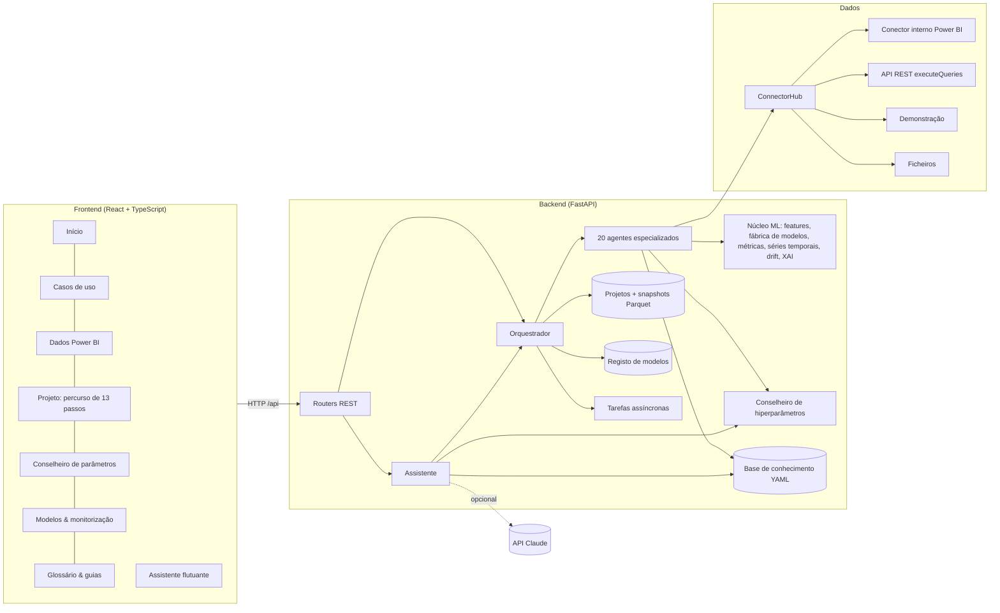

# Arquitetura do BI ML Studio

## Visão geral



## Camadas

| Camada | Pasta | Responsabilidade |
|---|---|---|
| Conhecimento | `backend/mlstudio/knowledge/` | Áreas, 25 casos de uso, 27 modelos com hiperparâmetros, 242 termos, 13 passos, guias e FAQ — em YAML validado por pydantic e com verificação de integridade das referências cruzadas. |
| Conectores | `backend/mlstudio/connectors/` | Interface `DataConnector`; adaptador do conector interno; API REST; demo; ficheiros; construtor e interpretador DAX. |
| Núcleo ML | `backend/mlstudio/ml/` | `FeatureBuilder` (transformador reprodutível), pré-processamento por cardinalidade, fábrica de pipelines, métricas e curvas, séries temporais, clustering/anomalias/associação, drift (PSI/KS/χ²), explicabilidade agnóstica. |
| Conselheiro | `backend/mlstudio/advisor/` | Perfil dos dados, regras por modelo × caso × objetivo, validação, espaço de pesquisa e indicador de risco. |
| Agentes | `backend/mlstudio/agents/` | Um agente por componente de ML (contrato `Agent` → `AgentResult`). |
| Orquestração | `backend/mlstudio/core/` | Projetos, registo de modelos, tarefas assíncronas, contexto partilhado, piloto automático. |
| Assistente | `backend/mlstudio/chat/` | Claude com ferramentas (ciclo gerido no servidor) e motor offline. |
| API | `backend/mlstudio/api/` | FastAPI; serve também o frontend compilado. |
| UI | `frontend/src/` | SPA React; renderizador genérico de blocos de resultados. |

## Contrato dos agentes

```python
class Agent(ABC):
    card: AgentCard            # id, nome, componente, papel, passo, capacidades, entradas/saídas, parâmetros
    def run(self, ctx: AgentContext, result: AgentResult, **params) -> None: ...
```

`AgentResult` contém `summary`, `insights` (info/success/warning/critical + termos do glossário), `recommendations`,
`blocks` (visualizações genéricas), `outputs` (dados estruturados para os agentes seguintes) e `next_step`.

**Blocos genéricos** — `kpis`, `table`, `chart` (bar/line/scatter/histogram com bandas, limiares e eixos secundários),
`heatmap`, `markdown`, `callout`, `code`, `params`, `download`. O frontend desenha qualquer agente sem código específico:
acrescentar um agente novo não exige alterações na UI.

## Agentes

| # | Agente | Componente | Passo |
|---|---|---|---|
| 1 | Enquadramento de Negócio | Pergunta → tipo de problema, alvo, KPI, custos | 1 |
| 2 | Dados Power BI | Exploração, ranking de tabelas, DAX, snapshot | 2 |
| 3 | Perfil (EDA) | Estatísticas, distribuições, poder preditivo, correlações | 3 |
| 4 | Qualidade de Dados | Score, nulos, duplicados, IDs, outliers, **leakage**, correções | 4 |
| 5 | Engenharia de Features | Plano de features, rácios, informação mútua | 5 |
| 6 | Seleção de Modelos | Ranking justificado por caso/dados/explicabilidade | 6 |
| 7 | Conselheiro de Hiperparâmetros | Recomendação, validação, risco, espaço de pesquisa | 7 |
| 8 | Treino | CV estratificada/temporal, random search/Optuna, leaderboard, registo | 8 |
| 9 | Previsão (séries temporais) | Naive sazonal, Holt-Winters, SARIMA, LightGBM global, backtesting, intervalos | 8 |
| 10 | Segmentação | Escolha de k, perfis, nomes, PCA | 8 |
| 11 | Anomalias | Isolation Forest, LOF, z-score robusto, motivos | 8 |
| 12 | Cabaz de Compras | Apriori, regras, matriz de afinidade | 8 |
| 13 | Avaliação | Curvas, lift, calibração, limiar ótimo €, segmentos | 9 |
| 14 | Explicabilidade | Permutação, PDP, odds ratios, motivos individuais, narrativa | 10 |
| 15 | Governança & Ética | PII (NIF/IBAN/…), equidade, proxies, AI Act, model card | 11 |
| 16 | Implementação (Power BI) | Promoção, scoring com motivos, escrita no Power BI, DAX | 12 |
| 17 | Monitorização | PSI/KS/χ², drift de previsões, desempenho real, simulação | 13 |
| 18 | Relatórios | Relatório executivo HTML/Markdown | — |
| 19 | Guia | Próximo passo, checklist, glossário contextual | — |
| 20 | Assistente | Chatbot com ferramentas (IA ou offline) | — |

O agente do passo 8 depende do tipo de problema (`TRAINERS`), e o piloto automático encadeia o percurso adequado
(`Orchestrator.flow`).

## Especialização por negócio

A especialização acontece em três níveis:

1. **Caso de uso** (`use_cases.yaml`): alvo, features típicas, modelos recomendados (com justificação), métrica principal,
   perfil (interpretabilidade, desequilíbrio, objetivo), custos de erro, armadilhas, saída para o Power BI, nível AI Act e
   atributos sensíveis. Todos os agentes leem o caso de uso do projeto.
2. **Área de negócio** (`areas.yaml`): KPIs, fontes típicas, decisões e riscos.
3. **Dados** (`DataProfile`): volume, dimensão, desequilíbrio, assimetria, correlação, sazonalidade, nº de séries — o
   conselheiro e a seleção de modelos adaptam-se ao perfil real do snapshot.

## Reprodutibilidade e MLOps

- Snapshot Parquet por projeto (hash incluído nos metadados).
- Pipeline único `FeatureBuilder → ColumnTransformer → modelo` serializado com joblib; o mesmo objeto faz treino,
  scoring em lote e scoring online. Os tipos vistos no treino são impostos no scoring.
- Registo com versões, estados (candidato → produção → arquivado), campeão, métricas CV/teste/baseline, parâmetros,
  versões das bibliotecas, estatísticas de referência para drift, conjunto de teste e ficha do modelo.
- `random_state = 42` em todos os componentes aleatórios.

## Assistente (chatbot)

- **Modo IA**: Messages API com ciclo de *tool use* gerido no servidor (as ferramentas operam sobre projetos e dados
  locais). Modelo `claude-opus-5-5` (configurável), raciocínio adaptativo com `effort` configurável, fallback
  server-side em recusas (`fallbacks: "default"`), *prompt caching* do system prompt.
  O histórico é **só-de-acréscimo** (o system prompt e as ferramentas são fixos; o contexto da página/projeto entra na
  mensagem do utilizador), para que os blocos de raciocínio reenviados continuem válidos.
- **Modo offline**: deteção de intenção + pesquisa TF-IDF (n-gramas de caracteres, sem acentos) + conselheiro + estado do
  projeto. Usado quando não há credenciais ou quando a API falha.
- 11 ferramentas: pesquisa de conhecimento, termo, casos de uso, modelo, recomendar/validar parâmetros, projetos,
  estado do projeto, agentes e executar agente (sem publicação no Power BI).

> Alternativa considerada: *Claude Managed Agents* (loop e sandbox alojados pela Anthropic). Optou-se pela Messages API
> com o ciclo no servidor da plataforma porque as ferramentas precisam de aceder a dados e projetos internos e o modo
> offline tem de continuar a funcionar sem dependências externas.

## Segurança e governança

- Segredos apenas por variáveis de ambiente (nunca no YAML).
- Caminhos de ficheiros validados (IDs com regex; exportações confinadas à pasta `exports`).
- Deteção automática de PII e de atributos sensíveis; avisos AI Act para casos de alto risco (crédito, RH).
- O assistente não publica dados; ações de escrita são feitas na UI.
